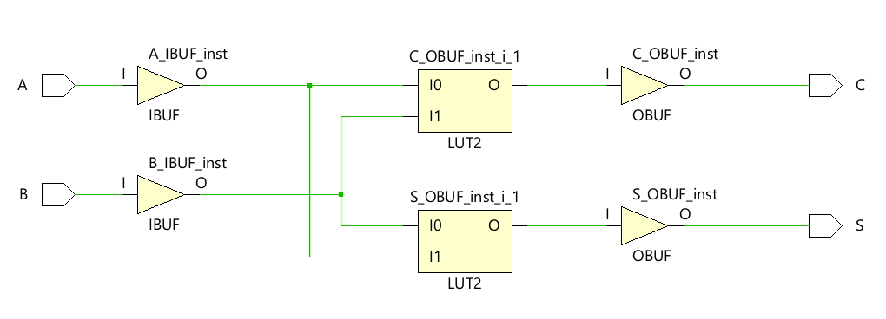
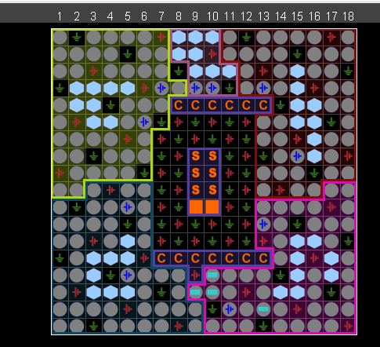
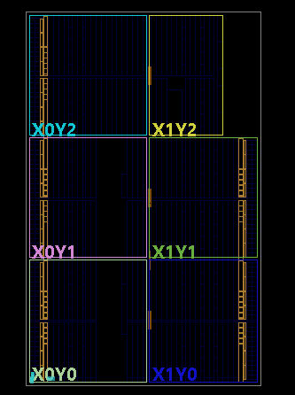

# Entity: half_adder 
- **File**: half_adder.v

## Diagram

## Ports

| Port name | Direction | Type | Description |
| --------- | --------- | ---- | ----------- |
| A         | input     | wire | Multiplicand/Addend bit input A |
| B         | input     | wire | Multiplicand/Addend bit input B |
| S         | output    | wire | Combinational Sum output (A ⊕ B) |
| C         | output    | wire | Combinational Carry output (A · B) |

## Hardware Performance Matrix (PDA Analysis)

The implementation was analyzed under standard environmental conditions ($25^\circ\text{C}$ ambient temperature, typical manufacturing process node, and $0\text{ pF}$ external capacitive output load) to isolate core hardware overhead.

| Parameter | Measured Value | Functional Details & Silicon Observations |
| :--- | :--- | :--- |
| **Logic Area** | 1 Slice LUT | Mapped entirely within a single 6-input dual-output LUT cell block. |
| **I/O Pin Count** | 4 Bonded IOBs | Tracks physical hardware routing for external ports: `A`, `B`, `S`, `C`. |
| **Worst-Case Delay ($T_{pd}$)** | 6.869 ns | Maximum critical path propagation time measured from Input `A` to Output `C` (Carry). |
| **Logic Component Delay** | 3.957 ns | Active transistor switching overhead (representing 57.6% of total path delay). |
| **Routing Net Delay** | 2.912 ns | Physical copper wire interconnect propagation overhead (representing 42.4% of total path delay). |
| **Total On-Chip Power** | 0.734 W | Combined active operational power draw across the device fabric. |
| **Dynamic Power** | 0.663 W | 90% of total distribution; heavily dominated by external I/O pad buffer switching currents. |
| **Device Static Power** | 0.072 W | Baseline silicon substrate leakage current power draw (10% of total distribution). |

## Key Engineering Insights

* **Optimal Logic Packing:** While a standard half-adder fundamentally consists of two distinct logic functions (XOR for Sum, AND for Carry), Vivado's physical mapping engine successfully packed both functions into **exactly 1 Slice LUT**. This leverages the dual-output flexibility of the Artix-7's 6-input LUT architecture, eliminating redundant logic cell utilization.
* **I/O Buffer Power Dominance:** Over **97% of the total dynamic power** ($0.646\text{ W}$) is consumed strictly by the I/O pads. Because the internal logic footprint is virtually negligible (1 LUT), charging and discharging the larger physical capacitances associated with the external device package pins accounts for almost the entirety of the dynamic energy profile.

## Physical Implementation & Silicon Mapping Layouts

### A. Physical Package Pin Routing
The layout of the hardware package die displaying the localized routing of active external output pins for Sum (`S`) and Carry (`C`):

### B. FPGA Fabric Floorplan Utilization
The physical coordinates and absolute logic footprint of the implementation relative to the overall Artix-7 silicon substrate:

## Reproducibility & Raw Verification Data

The unedited raw report text logs generated directly by Vivado's core hardware execution engines are fully available for verification:
* 📄 [Propagation Delay & Timing Report](half_adder_timing_report.txt)
* 📄 [Thermal Power Distribution Report](half_adder_power_report.txt)
* 📄 [Hardware Resource Utilization Report](half_adder_utilization_report.txt)